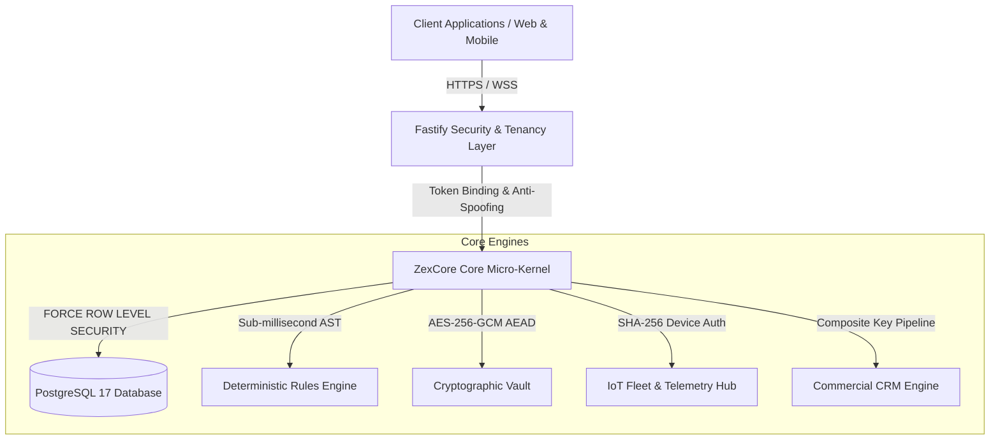

# What ZexCore is All About

> **The Sovereign Multi-Tenant Operating System for Vertical SaaS**  
> *One Core. Infinite Possibilities.*  
> 
> *Looking for a plain-English explanation without technical jargon? Read our [Plain-English Guide](plain-english-guide.md) or visit the interactive [About ZexCore Page](#/about).*

---

## Executive Summary

Building a specialized B2B vertical SaaS application (whether for cold-chain refrigerated logistics, industrial automation, clinical diagnostic workflows, commercial HVAC, or maritime fleet management) inevitably forces engineering teams into the **"18-Month Plumbing Trap"**.

Founders and engineering leaders repeatedly spend 12 to 18 months reinventing identical foundational infrastructure:
1. **Multi-Tenant Data Isolation**: Preventing cross-tenant data leaks.
2. **Deterministic Business Automation**: Letting users define alerts, state machines, and triggers without executing arbitrary, unverified code.
3. **Cryptographic Privacy & Compliance**: Encrypting sensitive PII at rest with envelope encryption while maintaining the ability to search by email or tax ID.
4. **IoT & Hardware Telemetry**: Authenticating edge devices and ingesting telemetry under high burst loads.
5. **Commercial Operations**: Managing pipeline stages, leads, contracts, and tenant subscriptions.

**ZexCore permanently solves this problem.** It provides a production-grade, kernel-isolated multi-tenant backend engine and domain module framework. Instead of building plumbing, teams build directly on top of ZexCore and launch vertical SaaS products in days.

---

## The 6 Architectural Pillars

### Pillar 1: Kernel-Enforced Multi-Tenancy (PostgreSQL 17 RLS)
- **The Problem**: Traditional SaaS uses application-level filtering (`WHERE tenant_id = x`). One omitted `where` clause in an analytical query or reporting job leaks one customer's private data to another.
- **The ZexCore Solution**: Both `ENABLE ROW LEVEL SECURITY` and `FORCE ROW LEVEL SECURITY` are enforced directly inside the database engine.
- Every database transaction sets `app.current_tenant_id` locally within the transaction (`is_local = true`). Queries cannot see other tenants' rows, even if a developer writes `SELECT * FROM crm_contacts;` with zero filters.

### Pillar 2: Deterministic Business Automation (AST Rules Engine)
- **The Problem**: Allowing non-technical operators to create custom alerts and automation rules usually tempts developers to use `eval()`, `new Function()`, or sandboxed runtimes (like `vm2`), leading to remote code execution (RCE) exploits.
- **The ZexCore Solution**: Condition evaluation is compiled into safe, deterministic Abstract Syntax Tree (AST) graphs.
- **Mathematical Safety**: Zero `eval()`, zero prototype pollution (`__proto__` and `constructor` blocked), and regex patterns strictly capped at 128 characters to prevent ReDoS.

### Pillar 3: Cryptographic Privacy & Compliance Vault
- **The Problem**: Data breaches leak sensitive customer PII, while GDPR Article 17 ("Right to be Forgotten") requires verifiable crypto-erasure.
- **The ZexCore Solution**: Field-level authenticated envelope encryption using `AES-256-GCM` with 96-bit unique random IVs per field.
- **Tenant Subkeys**: Keys are derived cryptographically using `HMAC-SHA256(masterKey, "tenant:" + tenantId)`. Even if one tenant's raw ciphertext is exposed, it cannot be decrypted with another tenant's credentials.
- **HMAC Blind Indexing**: Allows exact-match searching on encrypted fields (such as email or national IDs) without ever decrypting database columns.

### Pillar 4: Industrial Edge & Fleet IoT Hub
- **The Problem**: Devices deployed in the field (sensors, refrigerated trailers, CNC machinery) cannot maintain interactive OAuth sessions.
- **The ZexCore Solution**: Hardware tokens are hashed using `SHA-256` and stored as `token_hash`. Devices authenticate via `X-Device-Token` headers.
- **High-Throughput Ingestion**: Dedicated sliding window rate limiting supports up to 5,000 requests/minute per device IP for high-frequency sensor readings, with automatic incident dispatching when thresholds are breached.

### Pillar 5: Built-In CRM & Revenue Operations
- **The Problem**: Vertical software needs integrated deal tracking, pipeline stages, and customer communication records tied directly to physical equipment or software usage.
- **The ZexCore Solution**: Pre-built CRM module with composite-key invariants (`(tenant_id, id)`), tracking contacts, opportunities, and timelines with automated quotation dispatching.

### Pillar 6: "The Great First Ten Minutes"
- **The Problem**: Blank enterprise software feels cold, empty, and intimidating. Users churn in the first 5 minutes.
- **The ZexCore Solution**: An interactive onboarding experience where a business signs up, answers one question (*"What do you do?"*), and immediately receives:
  1. A finished sample site customized for their specific field.
  2. Realistic service listings with pricing and badges.
  3. A working inquiry form that dispatches directly into their CRM pipeline.
  4. An instant automated follow-up notification.
  5. An undo button to switch niches anytime.

---

## Who ZexCore Is Built For

1. **Vertical SaaS Founders**: Launch market-ready, enterprise-compliant software for specific industries (HVAC, cold chain, maritime, clinics, fleet management) in 10 minutes instead of two years.
2. **Enterprise Architects & CTOs**: Deploy sovereign backend infrastructure that complies with strict data residency, HIPAA, and GDPR regulations.
3. **Industrial & Logistics Operators**: Connect physical machinery directly to commercial invoicing and customer portals.

---

## Quick Reference Summary

| Capability | Implementation Standard |
|---|---|
| **Database Isolation** | PostgreSQL 17 `FORCE ROW LEVEL SECURITY` |
| **Field Encryption** | AES-256-GCM (12-byte IV, 16-byte Auth Tag) |
| **Searchable Ciphertext** | HMAC-SHA256 Blind Indexing |
| **Automation Engine** | Deterministic AST Interpreter (Zero `eval`) |
| **Hardware Auth** | SHA-256 Device Token Hashing |
| **HTTP Perimeter** | Sliding Window Rate Limiter + HSTS/CSP Security Headers |
| **Tenant Protection** | Anti-Spoofing JWT Token-to-Tenant Binding |
